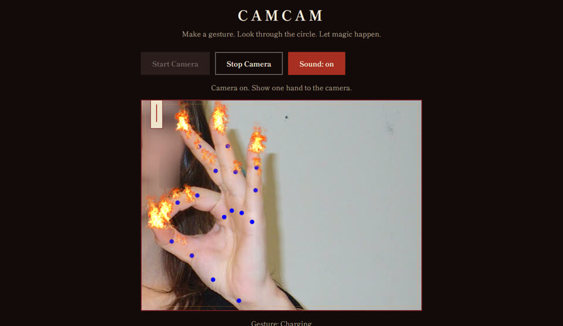
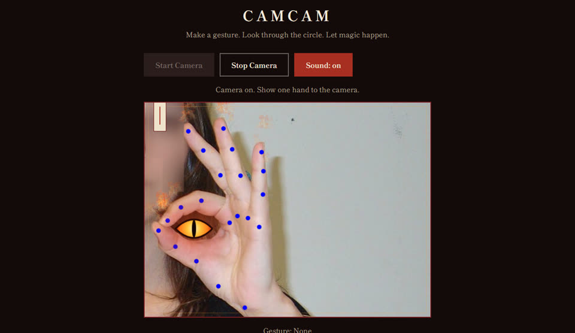
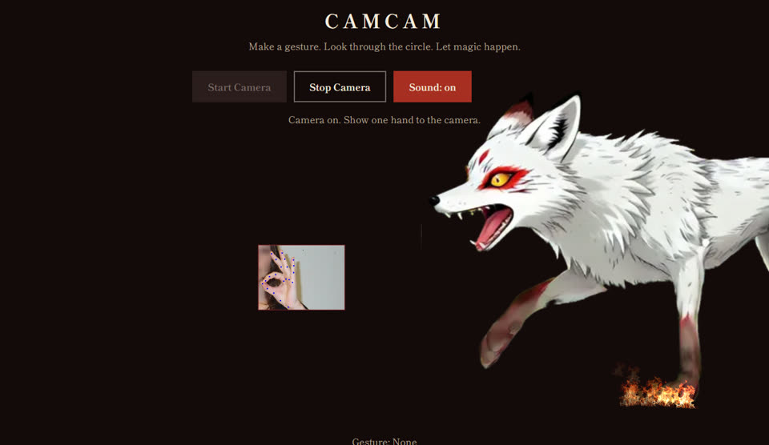
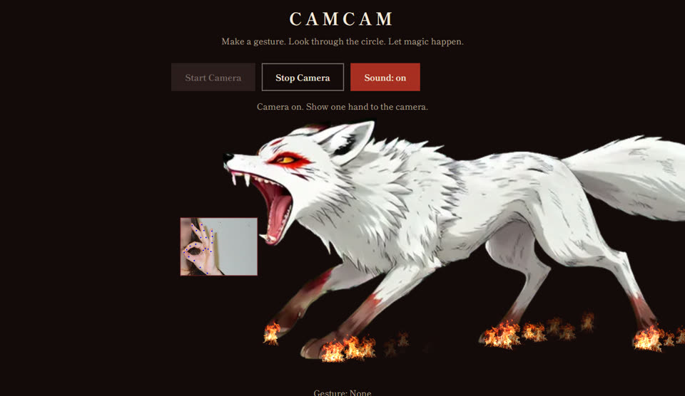

# CamCam

[Try CamCam live](https://project-keepsakes.github.io/camcam/)

A hand-tracking camera experience that runs in the browser. Hold up an OK ring to charge fire along your fingers, close it, and an eye opens in the ring. Then a fox runs in, chases down the camera view and swallows it.

| The eye opens | The fox gives chase | The jaws close |
| --- | --- | --- |
|  |  |  |

## How to Use It

1. Choose **Start Camera** and allow camera access.
2. Hold a near-OK ring: thumb and index fingertips close but not touching, other fingers up. It reads **Charging**, then **Charged** after about a second.
3. Close the ring. The eye opens, the fox comes, and the camera view returns a moment later.

Escape cancels, **Sound** mutes, and **Stop Camera** turns the camera off.

## Privacy

Camera frames stay in your browser and are never uploaded or recorded. The page asks for video only, never the microphone.

## Credits

- Sounds: CC0 recordings from Freesound, a [wolf howl](https://freesound.org/people/betchkal/sounds/500646/) and a [bite](https://freesound.org/people/Lunevix/sounds/464322/).
- Screenshots: a CC0 [OK hand photo](https://commons.wikimedia.org/wiki/File:OK_Hand_Gesture.jpg) from Wikimedia Commons, cropped with the face blurred.

## Development

Requires Node 20.11 or newer, no install step. Run `npm start` and open http://localhost:5173, or run the tests with `npm test`. Add `?proof` to the address for a **Test Summon** button and tuning readout.
